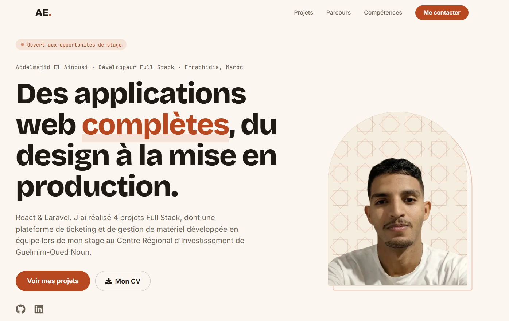

# Portfolio · Abdelmajid El Ainousi

Portfolio de développeur Full Stack (React & Laravel). Il présente mes projets, mon parcours et mes compétences, avec une identité visuelle inspirée du Sud marocain.

🔗 **En ligne : [elainousi-portfolio.vercel.app](https://elainousi-portfolio.vercel.app/)**



## Objectifs de conception

- **Lisibilité d'abord :** un recruteur doit comprendre qui je suis et ce que je sais faire en moins de 10 secondes.
- **Projets en preuve :** chaque projet précise le contexte, ma contribution, les points techniques et le lien vers le code.
- **Identité sobre :** palette sable et terre cuite, une seule couleur d'accent, typographie expressive.
- **Accessibilité :** HTML sémantique, navigation au clavier, contrastes vérifiés, respect de `prefers-reduced-motion`.
- **Performance :** aucune dépendance d'animation lourde, images optimisées et chargées en différé.

## Stack technique

| Domaine | Choix |
|---|---|
| Framework | React 19 (Vite) |
| Style | Tailwind CSS v4 (design tokens dans `@theme`) |
| Typographie | Bricolage Grotesque, Inter, JetBrains Mono (`@fontsource`, auto-hébergées) |
| Icônes | React Icons |
| Formulaire de contact | EmailJS |
| Animations | CSS natif + `IntersectionObserver` (composant `Reveal`) |
| Déploiement | Vercel |

> Adapte la version de React à celle de ton `package.json`.

## Fonctionnalités

- Sections : Hero, Projets, Parcours, Compétences, Contact
- Projets pilotés par un fichier de données (`src/data/projects.js`) : ajouter un projet = ajouter un objet
- Animations d'apparition au scroll, désactivées automatiquement si l'utilisateur le demande
- Formulaire de contact avec validation et retour d'état accessible (`aria-live`)
- Lien WhatsApp avec message pré-rempli
- SEO complet : balises Open Graph, Twitter Card, données structurées JSON-LD, `robots.txt`, `sitemap.xml`

## Structure du projet

```
src/
├── components/
│   ├── Navbar.jsx
│   ├── Hero.jsx
│   ├── Projects.jsx
│   ├── About.jsx          # Parcours (timeline)
│   ├── Skills.jsx
│   ├── Contact.jsx
│   ├── Footer.jsx
│   ├── SectionHeading.jsx # titre de section réutilisable
│   └── Reveal.jsx         # animation d'apparition au scroll
├── data/
│   └── projects.js
├── assets/
├── App.jsx
├── index.css              # design tokens (@theme) et styles de base
└── main.jsx
public/                    # favicon, og-image, CV, robots.txt, sitemap.xml
```

## Lancer le projet en local

```bash
git clone https://github.com/ABDELMAJID18990/[NOM-DU-REPO].git
cd [NOM-DU-REPO]
npm install
cp .env.example .env.local
npm run dev
```

Le site est disponible sur `http://localhost:5173`.

### Variables d'environnement

Le formulaire de contact utilise [EmailJS](https://www.emailjs.com/). Renseigne tes identifiants dans `.env.local` :

```
VITE_EMAILJS_SERVICE_ID=
VITE_EMAILJS_TEMPLATE_ID=
VITE_EMAILJS_PUBLIC_KEY=
```

Sans ces variables, le reste du site fonctionne, mais l'envoi du formulaire échoue.

### Scripts

| Commande | Action |
|---|---|
| `npm run dev` | Serveur de développement |
| `npm run build` | Build de production |
| `npm run preview` | Prévisualiser le build |
| `npm run lint` | Vérifier le code avec ESLint |

## Déploiement

Le site est déployé sur Vercel, avec déploiement automatique à chaque `push` sur `main`. Les trois variables `VITE_EMAILJS_*` sont définies dans *Settings → Environment Variables*.

## Performances

Scores Lighthouse (mobile) : **[À COMPLÉTER après ton test]**

## Projets présentés

- **CRIMATI** : gestion du matériel IT et helpdesk (projet d'équipe, stage)
- **Hôtel Étoile du Désert** : plateforme de réservation complète (React + Laravel)
- **Hôtel Étoile du Désert, version légère** : site statique bilingue avec réservation WhatsApp
- **Guelmim Snacks** : plateforme Click & Collect (React + Laravel)

## Contact

- 📧 abdelmajid.elainousi@gmail.com
- 💼 [LinkedIn](https://www.linkedin.com/in/abdelmajid-el-ainousi-b2b187298/)
- 🐙 [GitHub](https://github.com/ABDELMAJID18990)

---

© Abdelmajid El Ainousi. Le code est visible à titre de démonstration. Merci de ne pas copier le contenu ni l'identité visuelle à l'identique.